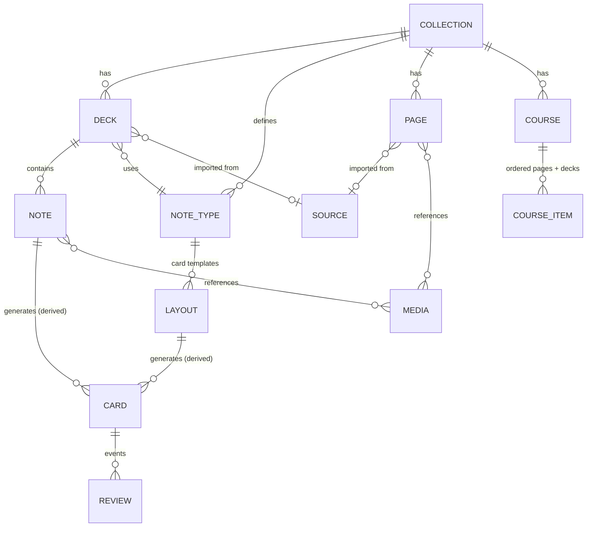

# Personal Language Flashcard App — Architecture & Design Blueprint (Final)

A **local-first, zero-server** foreign language flashcard and study app. Every device keeps a full copy of the user's data and studies offline. Devices sync through the user's *own* cloud storage (Google Drive first; Dropbox/iCloud/local folder pluggable). Sold once; if the developer stops working on it, nothing breaks.

---

## 0. Requirements and Where They Are Met

| # | Requirement | Where |
|---|---|---|
| R1 | Seamless sync between Android, iOS, and PC | §4 Sync |
| R2 | Lightweight, fast, smooth | §8 Performance budget |
| R3 | TTS, images, Japanese / Mandarin (simplified) / Korean + Hanja / English, typed and drawn input | §5 Study, §6 Asian languages, §7 Audio |
| R4 | Content beyond word/definition: grammar decks and long-form pages, made by each user and shareable | §2 Content model, §3 Sources and sharing |
| R5 | AI tools (Claude Code, Antigravity) can change the code and push content | §10 AI tooling |
| R6 | Sellable later (one-time purchase) on Google Play and the App Store; usable even if the developer stops | §11 Platforms, §12 Purchase and sunset |
| R7 | Android and iOS work with no internet connection; PC works the same as long as the decks are stored locally (e.g., Google Drive or Dropbox folders) | §1 Principles, §3.2 Local folders, §9 Offline guarantee |

---

## 1. Principles

1. **Local-first.** Each device holds the whole collection: decks, notes, pages, media, and review history. Study, browse, edit, and local file imports all work offline. The network is only used to sync, pull updates from Sheets/Docs/URLs, and optionally generate TTS.
2. **No backend database or user accounts.** The app is static files (a PWA now; Capacitor/Tauri shells later). The only outside services are the user's own cloud storage and Google APIs (plus a tiny stateless ~60-line Cloudflare Worker token-exchange helper for Web/PWA Google OAuth refresh that stores zero data).
3. **Events are the truth.** Every change the user makes is an immutable event. Card state, deck lists, and statistics are derived caches rebuilt from events. Sync means exchanging append-only event segments.
4. **Content is data, interactions are code.** Adding a new deck, grammar set, or lesson never needs code. Only a new *kind of interaction* (a new answer mode, a new page block) requires code.
5. **One content format.** Sheets, local files, Anki imports, AI tools, and shared decks all normalize into the same internal model and the same exportable `.flashpkg` format.
6. **Agents can run everything.** The app runs with no login and no network using sample data, so coding agents can build and test it end-to-end.
7. **Ship Phases 1–3 lean.** Keep `packages/core` data structures ready for Note Types, Pages, Courses, and Answer Modes from day one, but keep the Phase 1–3 UI laser-focused on a fast, polished Flashcards Deluxe replacement (Flip + FSRS + Sync + Sheets/Local Folders) before layering on Phases 4–8.

---

## 2. Content Model

### 2.1 Entities



- **Collection**: One user's data. One collection per sync store. Family members each have their own collection; they share *decks and pages*, not collections.
- **Note type**: A named list of fields. Each field has:
  - `key` (e.g., `word`, `reading`, `meaning`, `example`, `image`, `audio`)
  - `kind` (`text` | `reading` | `rich` | `image` | `audio`)
  - `lang` (BCP 47: `ja`, `zh-Hans`, `ko`, `en`, `zh-Latn-pinyin`, …)
  - flags such as `tts: true` and `sortKey: true`
  - Built-in presets: *Vocabulary (JA)*, *Vocabulary (ZH)*, *Vocabulary (KO)*, *Hanja*, *Grammar point*, *Sentence*, *Cloze*.
- **Layout** (card template): Which fields go on the front, which are revealed and in what steps, the answer mode (§5.2), which field to speak and when, and whether furigana is hidden on the front. Every new deck starts with a *Recognition* layout; *Production* and other layouts are one-tap toggles. Each layout keeps its own FSRS schedule.
- **Note**: One row of content: `fields: Record<fieldKey, string>`, `tags[]`, a `source_key` (the Card ID from a Sheet, a package note ID, etc.), and `provenance` (`user` | `import` | `ai`, plus `reviewed: boolean`).
- **Card**: A `note × layout × variant` (the cloze number, else `0`). **Cards are derived, not stored as truth.** Their IDs are deterministic (`uuidv5(note_id, layout_id, variant)`), so every device produces the same cards without syncing them. Only reviews sync.
- **Page**: A long-form lesson written in Markdown with app blocks (§2.3).
- **Course**: An ordered list of pages and decks. An item can be marked "unlocks after page X is read", so grammar explanations precede drill decks.
- **Media**: Image and audio files stored under their content hash (`sha256.ext`). Synced alongside events.
- **Source**: Where a deck or page came from (`google_sheets`, `google_docs`, `local_file`, `package`, `package_url`, or `native` for in-app authoring). Remembered so updates can be pulled again.

### 2.2 Grammar Content: What Needs Code (R4)

| Form | Example | Needs new code? |
|---|---|---|
| Grammar deck | Side 1 grammar point, side 2 explanation, side 3 example | **No.** Just the *Grammar point* note type |
| Cloze drill | `私は{{c1::学生}}です` | Yes, once: cloze parser + one-card-per-blank generation |
| Typed/choice/drawn drills | Conjugate the verb, pick the particle | Yes, once per answer mode (§5.2) |
| Textbook-style page | Explanation, tables, examples with audio | Yes, once: page renderer + courses |

### 2.3 Pages

- **Syntax**: CommonMark + GFM tables + directive blocks. **No raw HTML.** Shared pages are untrusted input (§13).
- **Blocks:**
  - Ruby: the same `漢字[かんじ]` / `{base|reading}` syntax as cards (§6.2).
  - `::say[食べます]{lang=ja}`: speaker button using the TTS chain (§7).
  - `:::example` … `:::`: example sentence box with optional toggleable translation.
  - `:::note` / `:::warning`: callouts.
  - `::image[alt]{src=media-or-path}`
  - `::cards{deck="Particles" tag="は-vs-が"}`: inline mini-study session.
  - `::deck-link{deck="…"}`: opens a deck.
- **Progress**: A `PageRead` event when the user reaches the end or taps "Done".
- **Authoring**: In-app Markdown editor with preview, `.md` files in a linked local folder (PC), a Google Doc (exported as Markdown, cached offline), or a package.

---

## 3. Sources, Import, and Sharing

Every source is **imported into the local collection**. After that, its content reaches the user's other devices **through sync**, even if those devices cannot access the original file. The original source only matters when pulling updates.

### 3.1 Google Sheets (Decks) and Google Docs (Pages)

- **Scope:** `drive.file` (non-restricted—no CASA security audit, no 7-day refresh token wall once published to Production). Users link Sheets/Docs with the **Google Picker** (multi-select), or the app creates a new Sheet from a template.
- **Columns are matched by header name, not position.** Headers map to note-type fields (`Word`, `Reading`, `Meaning`, …, `Tags`, `Card ID`). Unknown headers are ignored with a warning; duplicate headers and trailing empty rows are handled safely.
- **Card ID write-back:**
  - Rows missing `Card ID` get a UUID, written in one `batchUpdate`.
  - Just before writing, the app re-reads the range and writes only to rows whose content is unchanged and still lacks an ID (guarding against concurrent sorts/inserts).
  - Duplicate IDs (from copied rows) are flagged, and the later row gets a new ID.
  - If two devices race, the ID already in the Sheet wins on the next pull.
- **Identity:** `note_id = uuidv5(deck_id, card_id)`, so every device importing the same Sheet produces identical notes without colliding across different users' copies of a shared Sheet.
- **Deleted rows:** Emit `NoteArchived`. Restoring the row restores the note and its full review history.
- **Updates:** Cheap `modifiedTime` check on open/refresh (when online). Changed rows are diffed by `content_hash`.
- **Images in Sheets:** URL in an image column or `=IMAGE(url)` (read via `valueRenderOption=FORMULA`). Embedded in-cell images are not readable via API and trigger a warning.
- **Google Docs → Page:** Drive export as `text/markdown` (verify in Phase 0), parsed into a Page and cached offline.
- **Shared Sheets:** A recipient with view access links the Sheet read-only. The owner must sync once so `Card ID`s exist.
- **On PC:** `.gsheet` / `.gdoc` files in a Google Drive folder are cloud-only pointers; they work through the Sheets/Docs API path above and are cached offline after the first pull.

### 3.2 Linked Local Folders (PC — R7)

- The user links one or more local folders (e.g., `G:\My Drive\Flashcards` or `C:\Users\…\Dropbox\Flashcards`).
- **Web build:** File System Access API (`showDirectoryPicker`). **Tauri build (later):** native filesystem + watcher.
- **Readable files:**
  - `.csv` / `.tsv` (header row works like Sheets; `Card ID` column appended with permission once per folder).
  - `.xlsx` read-only via **`read-excel-file`** (MIT, lightweight, lazy-loaded; replaces frozen npm SheetJS CE). Never written back; rows match by `sortKey` field with a reconciliation prompt if renamed.
  - `.md` as Pages.
  - `.flashpkg` packages (§3.4).
  - Images/audio referenced by relative paths.
- **Scanning:** Rescans on open and on "Refresh"; files are re-imported only when modified time or content hash changes.

### 3.3 Other Imports
- **Anki `.apkg`** (later phase; `sql.js` lazy-loaded): note types, fields, cloze, media, optionally review history.
- **Paste or CSV upload** in the app (all platforms).

### 3.4 Package Format (`.flashpkg` — Sharing, AI, Backups)

A `.flashpkg` file is a zip archive containing:

```
manifest.json      # package_id, name, version, format_version, author, license, languages
note_types.json
decks/<deck>.jsonl # one note per line: { id, fields, tags, provenance }
layouts.json
pages/<slug>.md
courses.json
media/<sha256>.<ext>
```

- Validated against a JSON Schema in `packages/content-schema` with machine-readable errors.
- **Upgrades preserve reviews:** Re-importing a newer version of the same `package_id` updates content while matching notes by their package note ID.
- **Sharing & Family Library:**
  - Send `.flashpkg` directly (AirDrop, email, chat, Drive link).
  - **Subscribe to a package URL** (e.g., GitHub raw / Cloudflare Pages).
  - **Optional Family Library catalog:** A static `index.json` manifest listing `.flashpkg` URLs, titles, and descriptions that family members can browse and subscribe to in one tap.
  - Share a Google Sheet (§3.1).
- **Export:** Any deck, page, course, or full collection can be exported as `.flashpkg`.

---

## 4. Sync (R1)

### 4.1 Event Log & Deterministic Replay

Every mutation is an immutable event:

```ts
interface Event {
  id: string;            // UUIDv7
  device: string;        // device ID
  seq: number;           // per-device, gapless, strictly increasing
  hlc: string;           // hybrid logical clock (wall time + counter + device)
  type: EventType;       // ReviewRecorded, ReviewUndone, NoteUpserted, NoteArchived,
                         // DeckCreated, DeckSettingsChanged, DeckFSRSParamsChanged,
                         // LayoutChanged, NoteTypeChanged, PageUpserted, PageRead,
                         // CourseChanged, MediaAdded, SourceLinked, …
  v: number;             // event schema version
  payload: unknown;
}
```

- **Reviews:**
  - `ReviewRecorded { review_id, card_id, rating, reviewed_at, tz_offset, duration_ms, answer_mode, typed_answer?, fsrs_params_version, resulting_due_at }`
  - `ReviewUndone { review_id }`
- **Deterministic card state & FSRS drift protection:**
  - Active reviews for a card (excluding any referenced by `ReviewUndone`) are sorted deterministically by **`(reviewed_at, hlc, review_id)`**—never wall clock alone—so clock skew cannot cause device divergence.
  - Two devices reviewing the same card offline both count in deterministic order; Undo appends `ReviewUndone` and replays that card so a later sync can never resurrect it.
  - **Parameter / version drift protection:** Changing `target_retention`, running the FSRS optimizer, or upgrading `ts-fsrs` emits a versioned `DeckFSRSParamsChanged { params_version, effective_from, params }` event. Replay applies each review under the parameters active at its timestamp (preserving historical intervals) unless the user explicitly triggers *"Reschedule existing cards with new weights."*
- **Other changes** (note fields, settings, layouts): Per-field Last-Write-Wins decided by `hlc`.
- **Local materialized cache:** Card state, due queues, and stats live in local tables. Incoming events replay only affected cards (off the main thread in a Web Worker). Full rebuilds occur only after schema migrations.

### 4.2 Sync Store Layout

```
sync/v1/
  manifest.json                    # collection_id, format_version, min_app_version
  devices/<device-id>/
    head.json                      # last segment number, last seq (only this device writes it)
    seg-000001.jsonl.gz            # write-once event segments
    seg-000002.jsonl.gz
  snapshots/<device-id>-<seq>.json.gz
media/<aa>/<sha256>.<ext>
```

- **Zero write conflicts:** Each device writes exclusively to `devices/<id>/`, and segments are write-once.
- **Push:** Write new segment, then update `head.json`. **Pull:** Read each device's `head.json`, then download unseen segments.
- **Snapshots:** Periodically compact state into a snapshot recording each device's watermark so new devices bootstrap quickly.
- **Size:** ~100 bytes/review (~2 MB gzipped per 100k reviews). Reviews are never deleted.
- **Triggers:** On app open, network reconnect, backgrounding (push), every 20 reviews or 2 minutes while studying, and pull-to-refresh. Study UI never blocks on sync.
- **Forward/backward compatibility:** `manifest.json` carries `format_version` and `min_app_version`. Older app builds read what they understand, refuse to write to a newer format (prompting to update), and preserve unknown event types/fields untouched.

### 4.3 Transports & Auth

All transports implement one interface:

```ts
interface SyncTransport {
  list(prefix: string): Promise<FileInfo[]>;
  read(path: string): Promise<Uint8Array>;
  write(path: string, data: Uint8Array, opts?: { ifAbsent?: boolean }): Promise<void>;
}
```

| Transport | Status | Platforms | Notes |
|---|---|---|---|
| **Google Drive (`drive.appdata`)** | **Primary v1** | All | Uses Google Drive's hidden singleton `appDataFolder` (non-restricted, no CASA audit, impossible to create duplicate split-brain folders, users can't accidentally delete `head.json`). Separate `drive.file` scope handles user-visible Sheets/Docs and optional backups. All platform OAuth Client IDs live in the **same GCP project**. |
| **Local folder** | **v1 (PC)** | PC | Reads/writes a local folder (useful for local-only backups or desktop sync tools like Syncthing/OneDrive). |
| **Dropbox (`App folder`)** | **Future plugin** | All | Pluggable `SyncTransport` using browser PKCE with offline refresh tokens; deferred until needed. |
| **iCloud Drive** | **Future plugin** | iOS / macOS (Capacitor) | Optional zero-login sync for iOS-only App Store users. |
| **In-memory** | **v1 (Dev/Test)** | Tests / Dev | Powers `?device=a` / `?device=b` local dev mode and multi-device tests. |

**Google OAuth & Silent Refresh on Web/PWA (Solving iOS Standalone PWA):**
- **Web/PWA (including iOS home-screen PWA):** Uses a standard **redirect-based OAuth flow** (avoiding broken iOS standalone popups) paired with a **stateless ~60-line Cloudflare Worker token helper** (§12.3).
  - On sign-in, the app exchanges the auth `code` via the Worker (`POST /auth/exchange`), which holds only the Google `client_secret` env var and **stores nothing**.
  - The device stores its own `refresh_token` in IndexedDB and silently refreshes access tokens (`POST /auth/refresh`) every ~55 minutes—giving iOS, Android, and PC PWAs seamless background sync with zero re-login taps.
  - If the Worker is ever shut down, Web/PWA falls back to Google Identity Services (GIS) tap-to-renew.
- **Native shells (Capacitor / Tauri):** Use native Google Sign-In (Android/iOS OAuth client types), which issues long-lived refresh tokens directly to Keychain/Keystore with **no Worker needed**.

### 4.4 Safety Nets
- Call `navigator.storage.persist()` on first launch.
- Weekly "Back up your collection" reminder (`.flashpkg` export) if sync is not configured.
- Restoring on a new device: connect Google Drive (`drive.appdata` auto-discovers the collection) or import a `.flashpkg` backup.

---

## 5. Study Experience

### 5.1 Shell and Controls
- **Shell:** Pure static SPA (Vite + React + TypeScript + Tailwind), zero SSR dependencies, Capacitor-ready `dist/`. Bottom tabs on mobile (`Study`, `Library`, `Browse`, `Settings`), collapsible left rail on desktop, `viewport-fit=cover` + `env(safe-area-inset-*)`.
- **Startup:** Reads due counts and queues directly from local DB—zero spinners before the first card.
- **Ratings:** `ts-fsrs` v5 with **3 buttons by default** (`Again` / `Good` / `Easy` = `1 / 3 / 4`). Settings allow enabling the optional **Hard** (`2`) button or switching to 2 buttons (`Again` / `Good`).

| Action | Desktop | Mobile |
|---|---|---|
| Flip / next reveal step | `Space` / `Enter` | Tap card |
| Again | `1` / `←` | Swipe left / button |
| Good | `2` / `→` | Swipe right / button |
| Easy | `3` / `↑` | Swipe up / button |
| Hard (if enabled) | `4` / `↓` | Button |
| Replay audio | `R` | Tap speaker |
| Slow audio (0.75×) | `S` | Long-press speaker |
| Toggle furigana / hints | `F` | Tap script pill |
| Undo | `Z` / `Ctrl+Z` | Undo button |
| Edit note | `E` | Card menu → Edit (opens source Sheet for Sheet-backed decks) |

Shortcuts automatically disable when a text input has focus.

- **Study rules:**
  - Configurable new cards/day and max reviews/day per deck; source or random new-card order.
  - **Sibling burying:** Recognition and Production cards of the same note don't both appear on the same day.
  - Target retention per deck (default `0.90`); study day starts at `04:00` local time (configurable); reviews store `tz_offset`.
  - **FSRS optimizer (later):** On-device WASM (`fsrs-rs`) parameter fitting.

### 5.2 Answer Modes

Registered in a pluggable answer-mode registry; layouts pick one by name:

| Mode | Behavior | Suggested Rating |
|---|---|---|
| `flip` | Reveal steps, self-rate | — |
| `typed` | Type answer, show character diff vs. expected | Correct → Good, wrong → Again (overridable) |
| `choice` | 4 choices drawn from same field in same deck/tag | Same as `typed` |
| `cloze` | Masks each `{{cN::…}}` in turn; composable with `typed` | — |
| `listen` | Audio-only prompt on front | — |
| `draw` | Graded stroke drawing (§6.4) | Derived from stroke mistakes |

**Typed-answer matching (`packages/core`):**
- All languages: Unicode NFKC, trimmed, collapsed spaces, case-folded, punctuation ignored; `;` or `|` for alternate answers; `(…)` optional.
- `ja`: Live romaji → kana via `wanakana` (MIT); optional hiragana/katakana equivalence.
- `zh`: Tone marks and tone numbers compare equal (`ni3` = `nǐ`); optional ignore-tones toggle.
- `ko`: Unicode NFC so composed and decomposed jamo compare equal.
- **IME safety:** Ignore `Enter` while `event.isComposing` is true or `keyCode === 229`.

---

## 6. Asian-Language Support

### 6.1 Languages and Fonts
- **Supported:** `ja`, `zh-Hans`, `ko` (Hangul + Hanja), `en` (extensible to `zh-Hant` and others as data).
- **Explicit `lang` attributes** on every rendered field so CJK Han unification renders the proper regional glyph shapes (Japanese vs. Chinese vs. Korean Hanja).
- **Zero default web fonts (system-first):**
  - `ja`: Hiragino Sans, Yu Gothic UI, Noto Sans CJK JP
  - `zh-Hans`: PingFang SC, Microsoft YaHei, Noto Sans CJK SC
  - `ko`: Apple SD Gothic Neo, Malgun Gothic, Noto Sans CJK KR
  - Optional subsetted font packs downloadable if needed.

### 6.2 Ruby (Furigana, Hangul over Hanja, Pinyin)
- **Dedicated column + safe inline ruby:** Readings can live in a dedicated column (`Text 2` / `reading`) **and** inline `漢字[かんじ]` markup auto-renders as `<ruby>` wherever present.
- **Strict `X[Y]` rule:** Only parse `X[Y]` when there is **no space** before `[` AND the base run is Han characters (CJK extensions + `々 〆 ヶ`, or enabled via per-deck toggle). Thus `私の日本[にほん]` annotates `日本` only, and `word [formal]` is never touched.
- **`{base|reading}`:** Explicit form for kana bases, ateji, or per-character pairs (`{日本|に|ほん}`).
- **Hanja:** `學[학]` for Hangul reading; full 음훈 (e.g., `배울 학`) belongs in a dedicated field.
- **Pinyin:** Fields with `lang=zh-Latn-pinyin` convert tone numbers to tone marks with optional tone coloring.
- **Anki import:** Converts Anki's space-delimited ruby syntax on import.
- **Front-side toggle:** Furigana can be hidden on the front per layout and revealed on flip.

### 6.3 Offline Dictionary Packs (Phase 6)

Downloadable on web (cached locally once) and bundled in native builds:

| Pack | Source | License |
|---|---|---|
| Hanja (readings + English meanings) | Unicode Unihan (`kHangul`, `kDefinition`) + basic education Hanja list | Unicode License v3 |
| Kanji | KANJIDIC2 | CC BY-SA 4.0 (EDRDG) |
| Japanese words (optional, large) | JMdict | CC BY-SA 4.0 (EDRDG) |
| Chinese words | CC-CEDICT | CC BY-SA |

Attribution shown in About screen (share-alike applies to dictionary data, not app code).

### 6.4 Drawing (Phase 6)
Per-language mode: `graded` | `lookup` | `off`.
- **Graded (`ja`, `zh-Hans`):** Hanzi Writer (MIT) in quiz mode; Make Me a Hanzi (verify Arphic license before commercial sale) for Chinese, KanjiVG (CC BY-SA 3.0) for Japanese (kept separate due to stroke-order differences). Stroke data pre-cached per `draw` deck. Mistakes map to `0 → Easy`, `1–2 → Good`, `3+ → Again` (overridable).
- **Lookup (Hanja default + Browse tool):** Custom MIT/permissive stroke-matching recognizer over Make Me a Hanzi / KanjiVG data on web (avoid GPL libraries); **Google ML Kit Digital Ink Recognition** on native shells.
- **Canvas:** Pointer Events with `touch-action: none`, grid guide, undo stroke, clear, reveal.

---

## 7. Audio

### 7.1 Resolution Order
For any field configured to speak, the app resolves audio in order:
1. **Attached audio** on the note (from `.flashpkg`, Anki import, or user recording).
2. **Cached clip** in the local/synced media store, keyed by `sha256(normalized_text + voice_id)`.
3. **User's own cloud TTS key** (optional power-user setting: Google Cloud TTS or Azure via thin `TtsProvider` interface). Generated online at `1.0x`, saved to local media store *and* synced to `media/` so other devices never regenerate it.
4. **Device TTS** (`speechSynthesis`). Offline uses only `localService === true` voices; prompts once with OS instructions if a local language voice is missing.

> [!NOTE]
> **Family & shared decks:** Asking non-technical users to configure GCP billing/API keys is high friction. Pre-generating neural audio via **`tools/cli audio`** and bundling it into `.flashpkg` is the primary high-quality audio path for shared family decks.

- **Kanji pronunciation:** Layouts can speak from the `reading` field (or an optional per-note speech override) to prevent Japanese TTS misreadings.

### 7.2 Playback Reliability (iOS Safari & PWA)
- Single shared `<audio>` element unlocked synchronously on the first tap of a study session; set `navigator.audioSession.type = 'playback'` where supported so the iOS silent switch doesn't mute study audio.
- **2–3 card RAM lookahead:** Preload the next 2–3 cards' clips into in-memory `ObjectURL`s so auto-play fires synchronously on card flip.
- **Slow playback:** Client-side `audio.playbackRate = 0.75` (`preservesPitch = true`), or `utterance.rate` for device TTS. Clips are always generated at `1.0x`.

---

## 8. Performance Budget (R2)

Enforced in CI via `size-limit` and Playwright/Lighthouse checks:

| Metric | Target |
|---|---|
| Initial JS for the study screen | ≤ 150 KB gzipped |
| Cold start to first card (Pixel-class phone, 5k cards) | ≤ 1 s |
| Flip or rate to next card rendered | ≤ 16 ms (1 frame; persistence async) |
| Incoming sync of 500 events | ≤ 200 ms main-thread work (replay in Web Worker) |
| Default web fonts loaded | 0 |

- **Lazy-loaded modules:** `read-excel-file`, Markdown page renderer, Hanzi Writer & recognizer, dictionary packs, Google Picker, Anki importer, FSRS optimizer.
- **Off main thread:** Event replay, imports, and search indexing run in a Web Worker.
- **Virtualization:** Browse lists are virtualized.

---

## 9. Offline Guarantee (R7)

**Works fully offline on every platform once installed:**
- Studying (all answer modes), Browse, search, in-app editing, Pages, Courses, Undo, and stats.
- Graded drawing (for pre-cached decks) and draw-to-lookup / dictionaries (once packs are installed; bundled in native).
- Attached/cached audio + local device TTS.
- `.flashpkg` import/export.
- **PC:** Scanning and importing linked local folders (Drive/Dropbox desktop folders or any local directory).

**Requires network (queues/waits quietly when offline):**
- Cloud sync (`drive.appdata`), pulling Google Sheets/Docs/package URL updates, linking new Sheets via Picker, BYO-key TTS generation, downloading web dictionary/font packs, initial store purchase.

**iOS home-screen PWA note:** iOS standalone PWAs isolate storage from Safari; first-run onboarding prompts to connect sync or export a backup. (Early TestFlight via Capacitor is an optional fast-track for iOS testers if Safari storage quirks arise.)

---

## 10. AI Tooling & Repository Layout (R5)

### 10.1 Monorepo Layout

```
<repo>/
  AGENTS.md                 # build/test/run commands & architecture rules (CLAUDE.md points here)
  apps/
    web/                    # Pure static SPA / PWA (v1 on all platforms)
    token-helper/           # ~60-line stateless Cloudflare Worker for Web Google OAuth refresh
    mobile/                 # Capacitor shell (store phase / optional TestFlight)
    desktop/                # Tauri shell (store phase)
  packages/
    core/                   # Pure TS, zero DOM/React: events, replay, ts-fsrs, note types,
                            # layouts, card derivation, ruby/cloze/pinyin parsers, answer matching,
                            # .flashpkg import/export
    content-schema/         # JSON Schema + Zod + generated TS types for .flashpkg
    ui/                     # React components, study screen, page renderer
    platform/               # Interfaces: Storage, Files, SyncTransport, Auth, TtsProvider, Audio, Purchase
    platform-web/           # Dexie/IndexedDB, File System Access, Google Drive/Picker, speechSynthesis
    platform-capacitor/     # SQLite, Filesystem, native Google Sign-In, ML Kit, StoreKit/Play Billing
    platform-tauri/         # Native SQLite, filesystem watcher, native auth
  tools/cli/                # Node CLI: validate, build, audio, inbox
  content/samples/          # Sample decks/pages in ja, zh-Hans, ko (+ Hanja), en
  docs/                     # This blueprint, ADRs (docs/adr/), format specs
```

- **Hard rule:** `packages/core` must never import React, DOM APIs, or platform adapters.

### 10.2 Agent-Friendly Verification
- **No-login dev mode:** `pnpm dev` boots with sample data + in-memory `SyncTransport`. `?device=a` / `?device=b` runs two simulated devices in one browser sharing an in-memory sync store.
- **Automated tests:** Vitest unit tests (`core`), golden tests (ruby/cloze/pinyin/answer matching), `fast-check` property tests (arbitrary event interleaving across N devices converges identically), Playwright E2E (study, undo, import, 2-device sync, offline mode), migration tests against fixture DBs.
- **CI:** TypeScript `strict`, ESLint, Prettier, Vitest, Playwright, `size-limit`.

### 10.3 Pushing Content from AI Tools
- **CLI (`tools/cli`):** `validate`, `build`, `audio --provider google --key …`, `inbox`.
- **3 routes:** (1) Edit an already-linked Google Sheet, (2) drop `.flashpkg` into a linked PC `Inbox/` folder (auto-imported to `Inbox/imported/` and synced to phones), (3) share `.flashpkg` file or URL.
- **AI provenance:** AI-created notes/pages carry `provenance = { source: 'ai', reviewed: false }` with a "Needs review" badge/filter until confirmed or edited.
- **Optional local MCP server (Phase 7):** Reads local sync/backup mirror; exposes `list_decks`, `get_weak_cards`, `get_stats`, `propose_package`.

---

## 11. Platforms & Store Path (R6)

| Stage | Android | iOS | PC |
|---|---|---|---|
| **v1 (personal, family)** | Installed PWA (Chrome) | Home-screen PWA (Safari) + stateless Worker refresh | Installed PWA (Chrome/Edge) with linked local folders |
| **Optional pre-store** | Sideloaded Capacitor APK | TestFlight Capacitor build | — |
| **Store phase** | Capacitor on Google Play | Capacitor on App Store | Tauri (direct / Microsoft Store / Mac App Store) |

All shells wrap the identical static web build; platform differences live strictly inside `packages/platform-*`.
- **Native Picker bridge:** Google Picker is web-only; native shells open a static Picker page on the app's domain in the system browser and return selected file IDs via deep link.
- **Store compliance:** No app accounts (Apple account-deletion rule doesn't apply); Google/Dropbox are cloud storage connectors rather than app logins (confirm App Review 4.8 at submission); privacy label = zero developer data collection.

---

## 12. One-Time Purchase, Token Helper, and Sunset

### 12.1 Purchase Model
- **Mobile Stores:** Recommended **free download + single non-consumable "Unlock" IAP** (e.g., unlimited decks + cloud sync), using **StoreKit 2** and **Play Billing** directly (verified & cached on-device offline; no RevenueCat dependency).
- **Web/Desktop direct sales:** Offline-verified **Ed25519-signed license key** sold via Gumroad / Lemon Squeezy / Paddle.
- **Personal/family builds:** Compile-time flag disables the license gate.

### 12.2 Sunset Promise (Store Listing & EULA)
If development ever stops:
1. The final version continues working offline forever, and sync keeps working via the user's own Google Drive / Dropbox / local folder.
2. The developer publishes the source code and a final build with the license gate removed.
3. All formats (`.flashpkg`, `sync/v1`, event schema) remain documented in `docs/`.

**Minimal dependencies to keep alive (or hand over):** The GCP OAuth project (free), web domain (to prevent takeover of installed PWAs), and static Picker page (only needed for linking *new* Sheets on native).

### 12.3 Stateless Cloudflare Worker Token Helper (`apps/token-helper`)
- **Role:** Phase 2 default for Web/PWA Google OAuth. Exchanges Google auth codes for `{ access_token, refresh_token }` and refreshes tokens using the GCP `client_secret` env var.
- **Zero state:** No database, no KV, no user data, no logs. Refresh tokens live solely on the user's device.
- **Cost & Sunset:** \$0/month on Cloudflare Workers free tier (100k req/day). If ever shut down, Web/PWA falls back to GIS tap-to-renew; native Capacitor/Tauri builds never call it.

---

## 13. Security & Privacy
- **Untrusted shared content:** Raw HTML disabled in Markdown, strict URL scheme allow-list (`https:`, `media:`), strict CSP (no inline scripts), external links open outside the app—preventing malicious shared pages from reading stored tokens.
- **Least privilege:** `drive.appdata` (sync) + `drive.file` (user-picked Sheets/Docs only); Picker API key referrer-restricted.
- **Safe imports:** File size caps + zip path-traversal and zip-bomb checks in `fflate` extraction.
- **Zero tracking:** No analytics; opt-in crash reporting only if ever added.

---

## 14. Tech Stack

| Layer | Choice |
|---|---|
| UI | Vite + React + TypeScript + Tailwind; Pointer Events gestures |
| PWA | `vite-plugin-pwa` (Workbox) |
| Local DB | Dexie (IndexedDB) on web; SQLite on native — behind `Storage` interface |
| SRS | `ts-fsrs` v5; optional on-device WASM optimizer |
| Parsing | Custom ruby/cloze/pinyin parsers; `wanakana`; `read-excel-file` (lazy); `micromark` + directives (lazy); `fflate` |
| Drawing | Hanzi Writer + KanjiVG / Make Me a Hanzi; custom permissive lookup matcher; ML Kit (native) |
| Sync | Custom event log + `SyncTransport` (Google Drive `drive.appdata`, local folder, in-memory; Dropbox/iCloud later) |
| Auth | Google OAuth redirect + stateless Cloudflare Worker (`apps/token-helper`) on web; native Google Sign-In on Capacitor/Tauri |
| Hosting | Cloudflare Pages (static SPA) + Cloudflare Workers (stateless token helper) |
| Tests/CI | Vitest, fast-check, Playwright, size-limit, GitHub Actions |
| Native Shells | Capacitor (Android/iOS), Tauri (desktop) |

---

## 15. Build Plan

### Phase 0 — Assumption Spikes (Throwaway PoCs)
- [ ] iOS home-screen PWA: offline launch, `navigator.storage.persist()`, shared `<audio>` unlock, `navigator.audioSession.type = 'playback'` / silent switch.
- [ ] Google OAuth redirect + stateless Cloudflare Worker (`drive.appdata` + `drive.file`) inside an iOS standalone PWA and Android/desktop PWAs; confirm `appDataFolder` visibility across Web/Android/iOS OAuth clients in the same GCP project.
- [ ] `drive.file`: Google Picker multi-select of Sheets; Sheets API read + `batchUpdate`; Google Docs export as `text/markdown`.
- [ ] File System Access API (`showDirectoryPicker`) permission persistence in installed Chrome/Edge PWAs on Windows, reading Google Drive for Desktop folders.
- [ ] `ts-fsrs` v5 API (fields, learning steps, deterministic replay) and WASM optimizer package check.
- [ ] Hanzi Writer quiz with KanjiVG Japanese stroke data + Arphic/CC BY-SA license verification.
- [ ] CORS check for `.flashpkg` URLs (GitHub raw / Cloudflare Pages) and BYO Google Cloud TTS REST endpoint.

### Phase 1 — Core & Offline Single-Device App (Lean MVP)
- Monorepo setup (`pnpm` workspaces), `AGENTS.md`, CI, sample decks (`ja`, `zh-Hans`, `ko`, `en`).
- `packages/core`: immutable events, deterministic replay (with `(reviewed_at, hlc, review_id)` sort + FSRS param versioning), `ts-fsrs` v5 wrapper, Note Types, Layouts (Recognition default + 1-tap Production), deterministic Card derivation, safe CJK `X[Y]` ruby & pinyin parsers.
- `packages/platform-web` (Dexie behind `Storage` interface) + responsive PWA shell (mobile bottom tabs, desktop rail, safe-area insets).
- `flip` study screen with keyboard shortcuts, mobile swipe gestures, 3-button FSRS rating (+ optional Hard toggle), lossless Undo.
- CSV/TSV import, `.flashpkg` import/export, local backup prompt.
- **Milestone:** Fast, zero-login offline flashcard app usable daily on one device.

### Phase 2 — Cloud Sync (R1)
- `SyncTransport` interface + **Google Drive (`drive.appdata`)** transport + `apps/token-helper` stateless Cloudflare Worker + local-folder & in-memory transports.
- Write-once segments, `head.json`, snapshots, `format_version` gate, Web Worker replay.
- `fast-check` convergence property tests + 2-device Playwright sync tests (`?device=a` / `?device=b`).
- **Milestone:** Seamless Android + iOS + PC sync with zero Dropbox dependency.

### Phase 3 — Google Sheets & Local Folder Sources (R7)
- Google Picker (`drive.file`) multi-select, header mapping, race-safe `Card ID` write-back, soft-archiving, `modifiedTime` incremental pulls.
- PC linked local folders (`.csv`/`.tsv`, `.xlsx` via `read-excel-file`, `.md`, `.flashpkg`, `Inbox/` auto-import).
- Google Docs → Page import & `.flashpkg` URL subscriptions (including optional static `index.json` Family Library catalog).
- **Milestone:** Full Flashcards Deluxe replacement ready for daily personal & family use.

### Phase 4 — Richer Content & Answer Modes (R3, R4)
- Image fields (upload, resize, content-hash cache, sync).
- `typed` (with IME safety + language matchers), `choice`, `cloze`, and `listen` answer modes.
- Markdown Page renderer (no raw HTML, custom directives), Courses with unlock rules, AI provenance "Needs review" badge/filter.

### Phase 5 — Audio & TTS Pipeline
- Resolution chain (attached → cached media → BYO `TtsProvider` key → local `speechSynthesis`), iOS 2–3 card RAM preloader, `0.75×` pitch-preserved slow playback, media sync.

### Phase 6 — Drawing & Offline Dictionaries
- Graded drawing (`ja`/`zh-Hans`), draw-to-lookup (Hanja first), downloadable offline dictionary packs (Unihan, KANJIDIC2, JMdict, CC-CEDICT).

### Phase 7 — AI Tooling Extras (R5)
- `tools/cli` (`validate`, `build`, `audio`, `inbox`) and optional local MCP server for Claude Code / Antigravity.

### Phase 8 — Native Shells & Stores (R6)
- Capacitor (Android/iOS) and Tauri (PC) shells, SQLite adapter, native Google Sign-In (no Worker), static Picker deep-link page, ML Kit Digital Ink, StoreKit 2 / Play Billing + Ed25519 desktop license keys, optional Dropbox/iCloud transports, store listings with sunset promise.

---

## 16. Remaining Decisions (Pre-Launch)

1. **App name & domain:** Choose before creating the GCP OAuth project and Cloudflare Pages site.
2. **Free-tier limits for Store Unlock IAP:** Decide exact boundary (e.g., 2 decks local-only free; one-time Unlock for unlimited decks + cloud sync) before Phase 8.
